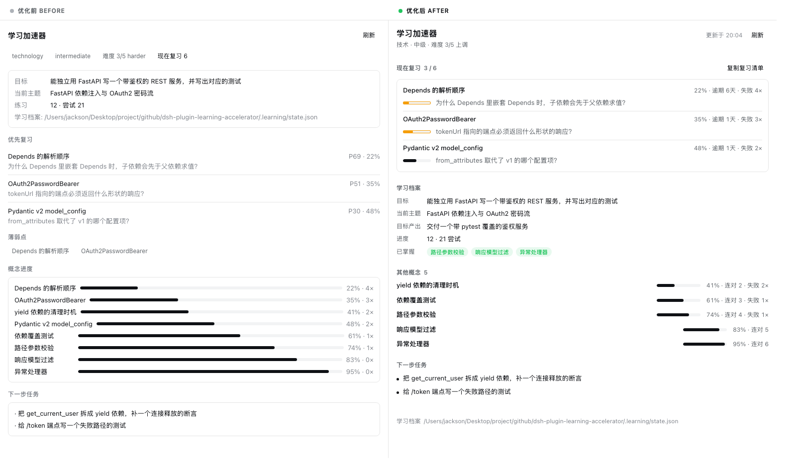
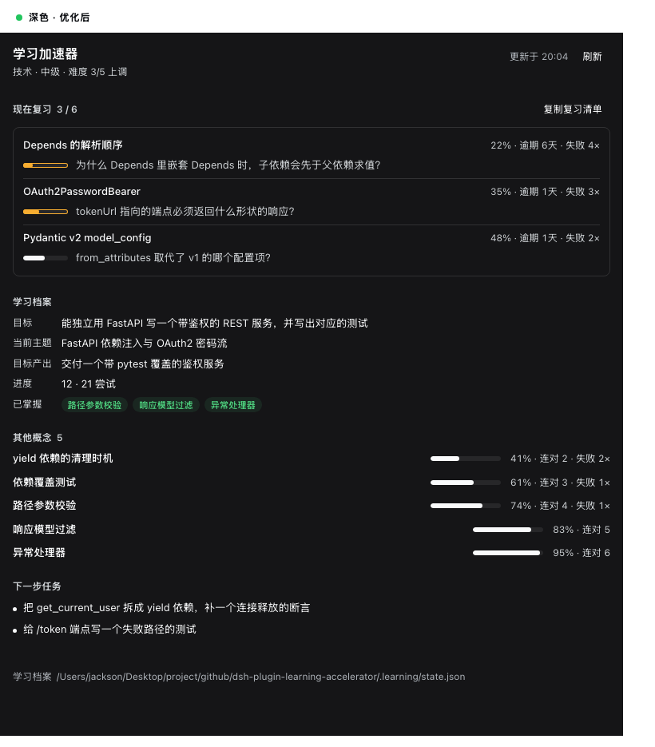
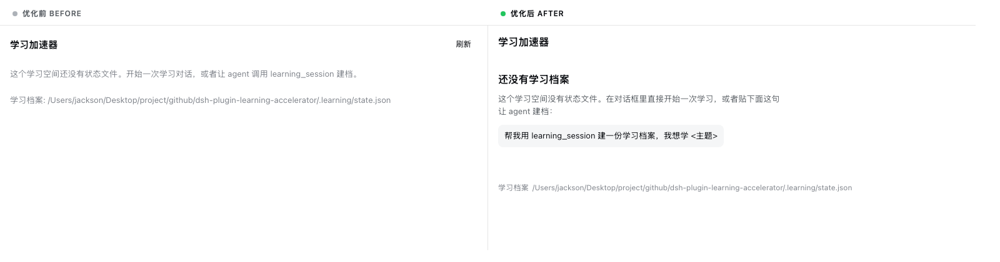
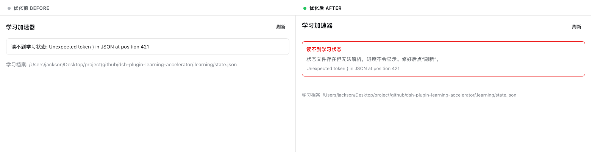
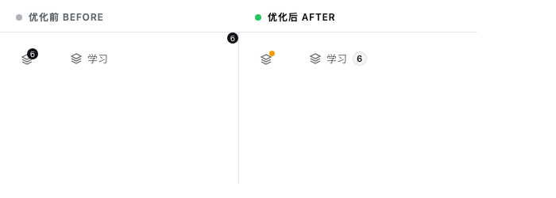
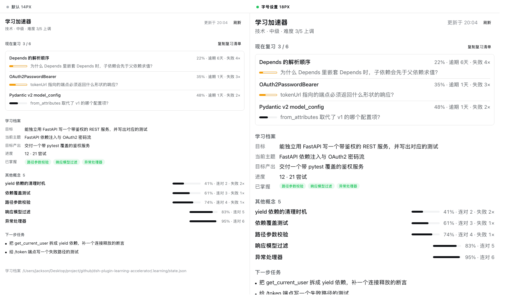
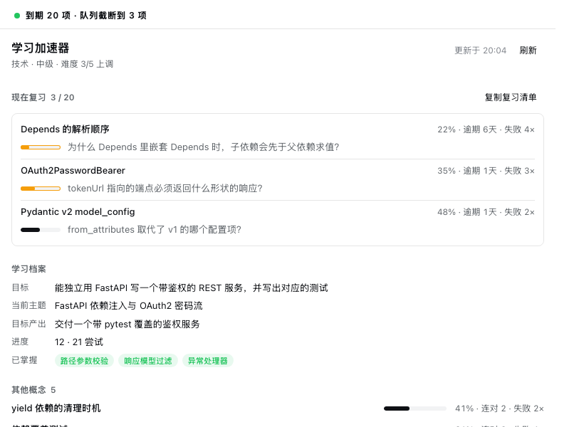

# Web 面板 UI 评审与优化方向

评审对象：`lib/client.js` 里的 `conversation.view` 面板（“学习”标签页）与 `sidebar.footer.action` 座位。

评审方法：把 `lib/client.js` 的样式块与 React 树**原样**抽出来，配上从
`@deepseek-ai/dsh-client-ui-theme` 里取到的**真实 token 值**，用一份有代表性的学习状态渲染成静态页，
浅色/深色各出一版，再和优化版并排比对。下面每条结论都有对应的代码锚点和对照图。

本文分两轮：第一轮（P0–P3，16 条）按严重度列出「写得不对」的问题；第二轮换几个角度，
重点是**可读性硬指标**、**系统里已有的组件**、以及**已经拿到却没用上的数据**。

> ## 状态：主要方向已实现
>
> 下面这些图**不再是设计稿，而是真实渲染的结果**。渲染管线把 `lib/client.js` 通过
> `tests/client-plugin.test.js` 同一个沙箱加载、用真实 payload 渲染、序列化真实 DOM 树，
> 再配上 bundle 自己注入的 CSS 和真实的 primitive 样式表；「优化前」一列来自
> `git show HEAD:lib/client.js`，两边用同一份 payload，所以是逐像素可比的。
>
> 已落地 **30 / 37** 条，另有 5 条部分实现、2 条未做，覆盖全部 P0 与多数 P1：token 名修正、
> 浅色对比度、字号轴、去重与重排、对齐、间距与字重、语义标签、骨架屏、刷新保留内容、新鲜度、
> 已掌握/连对/逾期等字段消费、`Tag` 组件替换 `Pill`、侧边栏 badge。完整状态表见文末
> [实现状态](#实现状态)。
>
> 未做的两条（窄容器退路、sparkline 趋势）分别需要容器查询与产品决策，已在状态表里说明原因。

> **关于引用方式**：本文**刻意不使用行号**，而是引用 CSS 选择器、函数名或代码片段。
> 原因是评审期间 `lib/client.js`（405 → 457 行）和 `lib/panel.js`（75 → 83 行）一直在被编辑，
> 每插入一段注释或 session plumbing，全文行号就会整体平移（实测平移 +6 到 +52 不等），
> 行号引用会立刻失效。选择器和符号是稳定的锚点，直接 grep 就能定位。
>
> 顺带一个由此暴露的问题：这些编辑也**让 `docs/extending.md` 自己的行号引用失效了**。
> 该文件里的引用是按编辑前的行号写的，实测现在的偏差是：
>
> | `docs/extending.md` 写的 | 现在实际应在 |
> |---|---|
> | `lib/client.js:30-31`（`id` 必须等于包名） | `lib/client.js:36-37` |
> | `lib/client.js:98-108`（样式块 / `data-plugin-css`） | `lib/client.js:104-114` |
> | `:481-490`（`client-plugin.test.js` 的 `data-plugin-css` 断言） | `tests/client-plugin.test.js:580-584` |
>
> `docs/extending.md` 本身没有被改动，所以 `git status` 不会提示这件事——
> 这也说明**用行号做文档锚点在这个仓库里已经出过一次问题了**。

对照图，前五张都是**左=优化前，右=优化后**：

**有数据（浅色）** — 最直观的一张



**有数据（深色）**



**空状态 / 错误状态 / 侧边栏座位**







**字号轴** — 左侧默认 14px，右侧把宿主的字号设置调到 18px；整块面板跟着缩放，布局不破



**队列被截断时** — 宿主最多给 5 条 `priority_reviews`，而 `counts.due` 是全部到期数，
标题因此渲染成 `3 / 20`，两个数字的关系不再需要猜



---

## 摘要

现状的问题分两类，优先级不同：

- **P0 是“代码没生效”，不是审美问题。** 有两个语义 token 名字写错了，被 `var(..., fallback)` 静默兜住，
  所以「低掌握度变黄」和「错误态变红」这两条规则**从来没有生效过**。修它只需要改两个字符串。
- **P1/P2 是信息架构和排版。** 同一份数据渲染了三遍（优先复习 / 薄弱点 / 概念进度），最该突出的
  「现在该复习什么」反而排在中段，掌握度条起点参差、字号阶梯过挤。

另外有一条**约束**值得单独记住，它推翻了一个看起来显然的改进方向：

> **浅色主题没有层级色阶。** `bg-base` 与 `bg-layer-1/2/3` 在浅色下全是 `#ffffff`，
> 只在深色下才有区分。所以在浅色下，**描边是唯一可靠的静态分组手段**，
> “用背景色代替边框”“靠底色区分卡片层级”这类做法在浅色主题里不会产生任何视觉效果。
> 这条同时解释了 P0 第 2 条（Pill 在浅色下隐形）和决定了 P2 第 11 条的做法。

下面按“先修正确性、再改结构、最后抛光”排序。

---

## P0 · 正确性缺陷

### 1. 两个语义 token 名不存在，导致两条规则静默失效

`lib/client.js` 的 `.dla-meter-fill.low` 和 `.dla-error` 的 `color`：

```css
.dla-meter-fill.low{background:var(--dsw-alias-state-warning,var(--dsw-alias-brand-primary))}
.dla-error{... color:var(--dsw-alias-state-error,var(--dsw-alias-label-primary))}
```

主题包里**没有** `--dsw-alias-state-warning` 和 `--dsw-alias-state-error`。实际存在的名字是：

| 代码里写的 | 主题里真实存在的 |
|---|---|
| `--dsw-alias-state-warning` | `--dsw-alias-state-warn-primary`（amber-500）/ `-secondary` / `-tertiary` / `--dsw-alias-state-warn-label` |
| `--dsw-alias-state-error` | `--dsw-alias-state-error-primary`（red-600 浅 / red-400 深）/ `-secondary` |
| — | `--dsw-alias-state-success-primary` / `-secondary` / `-tertiary` |

因为写了 fallback，浏览器不会报错，只会退回 `brand-primary` 和 `label-primary`。后果：

- `.dla-meter-fill.low` 与普通填充**同色**。`lib/client.js` 里 `percent < 40 ? ' low' : ''` 这条分支
  等于白写：22% 和 95% 的条除了长度完全一样（对照图左列「概念进度」）。而 meter 恰恰是这个面板
  最重要的信号。
- `.dla-error` 的文字退回 `label-primary`，错误卡片只剩一圈和普通卡片一模一样的中性描边，
  视觉上完全不像出错（对照图 `04-error-light.png` 左列）。

**方向**：改成真实名字，并且**不要依赖 fallback 掩盖拼写错误**。

```css
.dla-meter-fill.low{background:var(--dsw-alias-state-warn-primary)}
.dla-error{color:var(--dsw-alias-state-error-primary)}
```

顺带建议加一条测试，把「CSS 里出现的每个 `--dsw-alias-*` 都在主题里有定义」变成断言。
现有 `tests/client-plugin.test.js` 已经断言了「不许出现字面 hex / rgb / hsl」，再加一条 token 存在性断言
是自然的下一步，而且这类错误只有测试能挡住——肉眼和运行时都不会报。

### 2. 浅色主题下 Pill 不可见

`lib/client.js` 里渲染三个元信息 pill 的那段用 `Primitives.Pill`，薄弱点的 `Primitives.Pill` 也是。
`Pill.module.css` 的默认样式是：

```css
.pill{ border:none; background: var(--dsw-alias-bg-layer-2); }
```

而浅色主题里 `--dsw-alias-bg-layer-2` = `#ffffff`。**关键点：浅色下整个层级色阶都是白的**——
从主题文件里取到的定义是：

| token | 浅色（`body`） | 深色（`body[data-ds-dark-theme]`） |
|---|---|---|
| `--dsw-alias-bg-base` | `#ffffff` | `#151517` |
| `--dsw-alias-bg-layer-1` | `#ffffff` | `#232324` |
| `--dsw-alias-bg-layer-2` | `#ffffff` | `#2c2c2e` |
| `--dsw-alias-bg-layer-3` | `#ffffff` | `#353638` |

会话面板的容器背景也是 `bg-base`（`dsh-client-ui-conversation` 里
`.root{background:var(--dsw-alias-bg-base)}`）。所以在浅色主题下，**Pill 的默认底色在任何宿主表面上
都等于背景色**，等于没有；深色下因为 `bg-layer-2` = `#2c2c2e` 才正常。

也就是说：**同一个组件在两个主题下的分组效果不一致**，而失效的那个是默认主题。
（对照图 `01-populated-light.png` 左列的「technology / intermediate / 薄弱点」退化成纯文本。）

**方向**：不要依赖 Pill 的默认底来做“在面板上可见的 chip”。两条路：

1. 需要 chip 形态时，自己加一圈随主题的内描边（注意测试禁止字面 hex，必须用 token）：
   `box-shadow: inset 0 0 0 1px var(--dsw-alias-border-l2)`。
2. 更好的做法见 P1 第 4 条：**这些 chip 本来就不该存在**。

> **由此推出一条通用约束**：浅色主题没有层级色阶，所以**不要用 `bg-layer-*` 做分组**——
> 它在浅色下不产生任何视觉差异。浅色下能用的表面差异只有描边
> （`--dsw-alias-border-l*`）和交互色（`--dsw-alias-interactive-bg-hover` = `#2631480f`，
> 浅深两色都可用的淡染）。这条约束直接影响 P2 第 11 条。

### 3. 枚举值直接进 UI，中文界面里漏英文

`lib/client.js` 渲染三个元信息 pill 的 `Primitives.Pill` 调用：

```js
String(data.profile?.learning_domain ?? 'general'),
String(data.profile?.level ?? 'beginner'),
`${t('panel.difficulty')} ${data.difficulty?.current ?? 1}/5 ${data.difficulty?.next_adjustment ?? 'same'}`
```

`learning_domain` / `level` / `next_adjustment` 是原始枚举，没走 `t()`。所以中文界面里出现的是
「technology」「intermediate」「难度 3/5 up」——`up` / `same` 这种英文单词混在中文句子里。

**方向**：`panel.js` 的注释写着 “shaping happens once here rather than on every browser render”，
枚举映射放在 `panel.js`（host 侧）比放在 `STRINGS` 里更符合这个定位，而且 `zh` / `en` 两份字典也不会漏。
如果放在客户端，记得 `STRINGS.zh` 和 `STRINGS.en` 要同时补齐，否则 en 会直接漏出枚举值。

---

## P1 · 信息架构：同一份数据渲染了三遍

### 4. `priority_reviews` / `weak_concepts` / `concept_progress` 大面积重叠

拿对照图左列的实际数据看：

| 概念 | 优先复习 | 薄弱点 | 概念进度 |
|---|---|---|---|
| Depends 的解析顺序 | P9 · 22% | ✔ | 22% · 4× |
| OAuth2PasswordBearer | P8 · 35% | ✔ | 35% · 3× |
| Pydantic v2 model_config | P6 · 48% | ✔ | 48% · 2× |
| 依赖覆盖测试 | P5 · 61% | ✔ | 61% · 1× |
| yield 依赖的清理时机 | — | ✔ | 41% · 2× |

同一批概念、同一个掌握度数字，出现在三个 section 里。这正是书中
**“emphasize by de-emphasizing”** 要避免的：三处同时喊“这些概念很弱”，结果没有任何一处更突出。
面板反而显得又长又平。

**方向**：掌握度只留一个“家”。

- **现在复习**：承载到期项，带 prompt 和掌握度条（信息最全，放第一位）。
- **其余概念**：只放非到期的那部分，标题里写明数量（`其他概念 4`），避免误以为总共只有 4 个。
- **薄弱点 chips**：去掉。薄弱由掌握度条的琥珀色 + 失败次数表达就够了，不需要第三遍。

按这个方向，弱点的表达从“三处重复”变成“一处带颜色的条 + 失败次数”，扫读成本明显下降。

### 5. 最该突出的内容排在中段

`lib/panel.js` 的 `Weakest first` 注释自己写着：

> Weakest first: the panel's job is to make the next thing to fix obvious.

但视觉上最重的是顶部三个 chip + 一大张卡片（里面还塞了状态文件路径），
「现在该复习什么」被挤到中间，而且**没有容器**——它周围两个 section 都是卡片，只有它是裸列表。

**方向**：到期队列提到第一位并给最强容器；元信息（领域/级别/难度）降级成标题下面一行小字，
不再占三个 chip 的位置。

### 6. 状态文件路径占了不相称的权重

`lib/client.js` 档案卡片里的 `dla-note` 和空状态分支里的 `dla-note`。它是一个每次都一样的开发者信息，
却出现在面板最显眼的两处，还用 `word-break:break-all` 从中间硬断长路径。

**方向**：移到面板底部一行小字，单行省略号截断，完整值放 `title`：

```css
.dla-foot-path{flex:1;min-width:0;overflow:hidden;text-overflow:ellipsis;white-space:nowrap}
```

⚠️ 一个坑：**不要用 `direction:rtl` 做左侧省略**。路径以 `/` 开头，rtl 截断会把开头的 `/` 甩到末尾，
变成 `Users/.../state.json/`。我第一版就是这么翻车的，故记录在此。

### 7. 「到期数」和「列表长度」对不上，且没有解释

`lib/client.js` 里到期 chip 用的是 `data.counts.due`，而 `priority_reviews.map(PriorityReview)` 的列表用的是 `data.priority_reviews`。
这两者**不是同一个集合**：`lib/learning-store.js` 的 `priorityReviews(onDate, limit = 5)`
是 `dueReviews` 排序后**截断到前 5 条**的结果，而 `counts.due` 是 `due_reviews.length`。

所以“到期 6”配一个 4 条的列表（≥6 个到期项时是 5 条）时，用户看到两个不同的数字却没有任何说明；
而且**超出前 5 的到期项在面板上完全没有出口**。

**方向**：要么列表标题写「到期 6 · 显示最紧急 5 条」，要么 chip 直接用 `priority_reviews.length`。
不能让两个数字无声地并存。

---

## P2 · 排版与对齐

### 8. 掌握度条起点参差（最影响可扫读的一条）

`lib/client.js` 的 `.dla-concept-name` 用 `min-width:120px` 给概念名留位置。问题是 `min-width` 只是**下限**：
短名字占 120px，长名字会更宽，于是**每根条的起点都不一样**。8 行下来条是锯齿状的
（对照图左列「概念进度」看得很清楚），右侧 `22% · 4×` 也没右对齐。

这直接毁掉了这个 section 唯一的用途——横向比较。

**方向**：改成固定列宽的 grid。书中说法是“有最优宽度的元素用固定宽度，不要靠内容撑”：

```css
.dla-concept{display:grid;grid-template-columns:minmax(0,1fr) 96px 84px;align-items:center;gap:12px}
.dla-concept-name{overflow:hidden;text-overflow:ellipsis;white-space:nowrap}
.dla-concept-meta{text-align:right;font-variant-numeric:tabular-nums}
```

三个关键点：名字列 `minmax(0,1fr)`（才能真的触发省略号）、数值列固定宽 + 右对齐、
数字用 `tabular-nums`（否则 `22%` 和 `61%` 宽度不同，右边缘还是会抖）。

### 9. 字号阶梯太挤

现状是 12（section 标题 / chip）/ 13（正文）/ 15（面板标题）。12→13 只差 **8%**，
违反“相邻档至少差 25%”的原则——这两档几乎分不出主次，等于白设一档。

**方向**：12 / 14 / 16。section 标题保留 12 是对的（书中：section 标题本质是 label，就该小），
正文提到 14 和宿主环境一致，面板标题 16。

### 10. 间距没有收敛到一个 scale

现值 2 / 4 / 6 / 8 / 12 / 16（样式块）。其中 6（`.dla-card` gap）和 8（`.dla-section` gap）
相差 33% 却同时存在，属于没有意义的两个档；`.dla-review` 的 `gap:2px`（`.dla-review`）也太紧。

**方向**：收敛到 4 / 8 / 12 / 16 / 24。层级关系一次说清：section 之间 24 > 卡片内 8~12 > 行内 4~8。
现状的 16 > 8 本身没错，但中间那档 6 让它变得随意。

### 11. 卡片策略不统一

同一层级三种处理：档案、概念进度、下一步任务都套了描边卡片，只有优先复习**没有容器**。
四个 section 里三个套了描边卡片，只有最该突出的那个是裸列表——这不是“更少的边框”，
而是**分组规则不一致**，读者得重新猜每一段的边界在哪。

书中建议“先试更少的边框”，常见的替代是用背景色分层，但**在这里行不通**：
浅色主题下 `bg-base` / `bg-layer-1/2/3` 全是 `#ffffff`（见 P0 第 2 条），
换成背景色等于什么都没做。所以浅色下描边是唯一可靠的静态分组手段。

**方向**：既然只能靠描边，那就**减少卡片数量而不是替换卡片材质**——
只给出最强的一个分组（到期队列）套卡片，其余 section 靠间距 + 全大写小标题分组。
对照图右列就是这么做的：整页只剩一圈描边，层级反而更清楚。

---

## P3 · 状态与细节

### 12. 空状态没有行动指引

`lib/client.js` 的空状态分支 渲染的是一段灰字 + 一个原始路径，文案还告诉用户
“或者让 agent 调用 `learning_session` 建档”——**这是写给开发者的，不是写给学习者的**。
书中说空状态是优先级而不是事后补丁。

**方向**：标题 + 一句人话 + 一个**能直接粘的动作**。
注意面板是只读的，不能假装有个按钮能开启学习（**never imply functionality you aren't ready to build**，
`lib/client.js` 侧边栏那段注释里已经守住了这条），所以给“可复制的一句话”是诚实的做法：

> 还没有学习档案
> 这个学习空间没有状态文件。在对话框里直接开始一次学习，或者贴这句让 agent 建档：
> `帮我用 learning_session 建一份学习档案，我想学 <主题>`

### 13. 错误状态把原始异常当正文

错误分支里那行把 `${t('error.state')}: ${detail}` 拼成一句话，`detail` 是原始 JS 异常
（`Unexpected token } in JSON at position 421`），它和 HTTP 状态码一起构成了卡片**唯一**的内容。

**方向**：先一句人话（读不到学习状态 / 修好后刷新），原始异常降级成小字。
错误色修好之后（P0 第 1 条），红标题 + 红描边已经足够传达。

### 14. `P9` 是内部术语

`lib/client.js` 里渲染 `P${item.priority}` 的那一行。学习者不知道 `P` 是什么，而且列表**已经**按优先级排好了，
把分数再显示一遍收益很低。

**方向**：改成「优先级 9」或直接去掉，让排序本身表达优先级。
如果要留，至少别用只有一个字母的缩写。

### 15. 侧边栏 badge

`lib/client.js` 的 `.dla-badge` 规则：

```css
.dla-badge{position:absolute;top:0;right:0;...;
  background:var(--dsw-alias-button-primary-fill);color:var(--dsw-alias-label-primary-foreground)}
```

三个问题：

1. `button-primary-fill` 在浅色下是**近黑**（`brand-primary` = `#0f1115`），一个实心黑点在浅色侧栏里
   比它标记的图标还响，读起来像告警。
2. `right:0` 让宽版（侧边栏按钮的渲染代码，`wide` 时用 `dla-action` 而非 `rail`）的 badge 被推到整行最右，
   和它计数的图标/标签**脱开**（对照图 `05-sidebar.png` 左列）。
3. rail 版只有 28px 宽，却要塞下 16px 图标 + 2 位数编号，badge 压在图标字形上。

**方向**：

- 换成 `--dsw-alias-state-warn-primary`：语义上也更对（有到期项要处理），而且不再抢戏。
- 宽版用 `margin-left:auto` 让数字**跟在标签后面**，而不是飘到行尾。
- rail 版 28px 放不下编号就**只放一个点**，数量留在 `title` / `aria-label`（现有代码已经正确设置了
  这两个属性，所以无障碍信息不丢）和宽版里。

### 16. `.slice(0, 12)` 静默截断

`lib/client.js` 的 `data.concept_progress.slice(0, 12)`：超过 12 个概念时不给任何提示，
用户不知道还有没显示的。

**方向**：至少写明「12 / 23」，或加一个「显示全部」。

---

## 建议的落地顺序

| 顺序 | 内容 | 改动量 | 收益 |
|---|---|---|---|
| 1 | 修两个 token 名（P0-1）+ 加 token 存在性断言 | 2 行 + 1 个测试 | 让两条已写好的规则真正生效 |
| 2 | 枚举本地化（P0-3） | 小 | 中文界面不再漏英文 |
| 3 | 合并重复 section + 重排优先级（P1-4/5） | 中 | 面板变短，重点变清楚 |
| 4 | 路径下沉 + 到期数口径（P1-6/7） | 小 | 去掉噪音和不一致 |
| 5 | 对齐 / 字号 / 间距 scale（P2-8/9/10） | 中 | 可扫读性 + 系统感 |
| 6 | 卡片策略统一（P2-11）、状态与细节（P3） | 中 | 抛光 |

第 1 步单独拿出来说，是因为它是**整个评审里唯一一条“当前代码没生效”的问题**，
改动最小、收益最直接，而且不修的话后面所有关于颜色的调整都建立在错误的前提上。

---

## 与现有测试的关系

`tests/client-plugin.test.js` 目前锁定了三件事：

- style 标签带 `data-plugin-css="dsh-learning-accelerator"`（HMR 清理用）；
- CSS 里**不许出现字面 hex / rgb / hsl**——上面所有配色建议都只用 token，不违反；
- 侧边栏文本是 `学习 1`（label + badge 无分隔符）。P3-15 改的是 badge 的颜色和位置，
  宽版仍渲染数字，这条断言不受影响。

改文案时记得 `STRINGS.zh` 和 `STRINGS.en` 两份字典都要动（`lib/client.js` 的 `STRINGS`），否则英文界面会漏中文。

本文档自身的测试情况：`tests/docs.test.js` 的「every relative markdown link resolves」会检查正文里的
相对链接，所以本文引用的 5 张对照图都在 `docs/panel-ui-review/` 下且可以被解析到（实测 7 项全过）。

**一个打包上的副作用**：`package.json` 的 `files` 里包含 `docs`，所以这 5 张图（约 600 KB）
会一起进 npm tarball。如果不想让评审图占用发布体积，可以往 `files` 里加否定项
`"!docs/panel-ui-review"`——但注意 `tests/docs.test.js:76-79` 会遍历 `files` 并断言**每个条目都存在**，
`!` 前缀不是一个真实路径，那条断言会挂。要加否定项，得先让那个测试跳过 `!` 开头的条目。

---
---

# 第二轮：换书里还没用到的角度

第一轮集中在「哪里写错了 / 哪里重复了」。这一轮换成书里另外几组视角，结论集中在四类：

1. **可读性硬指标**——对比度、字号偏好、行高、行宽。这些是可以量化的，不靠审美。
2. **系统里已经有对的组件**——第一轮有几条我建议手写 CSS，其实宿主已经给了更合适的 primitive。
3. **结构、语义与间距**——书里 ch02/ch03 的几条还没用上。
4. **已经拿到却没用上的数据**——`panel.js` 转发了不少字段，客户端一个都没渲染。

## A. 可读性硬指标

### 17. 浅色主题的辅助文字对比度不达标（3.71:1）— P0

从主题里取出真实取值后算的（WCAG 2.x，`#ffffff` / `#151517` 为底）：

| 角色 | 浅色 | 对比度 | 深色 | 对比度 |
|---|---|---|---|---|
| `label-primary` | `#0f1115` | 18.90:1 ✅ | `#f9fafb` | 17.45:1 ✅ |
| `label-secondary` | `#61666b` | **5.80:1** ✅ | `#cfd3d6` | 12.11:1 ✅ |
| `label-tertiary` | `#81858c` | **3.71:1** ❌ | `#adb2b8` | 8.54:1 ✅ |

正常字号文本的 AA 门槛是 4.5:1。**浅色 tertiary 只有 3.71:1，不达标**；深色 tertiary 8.54:1，
绰绰有余。也就是说这又是**只有浅色主题出问题**——和第一轮第 2 条（Pill 隐形）同一个形状。

而面板把**所有辅助文字都放在 tertiary 上**：

| 用途 | 位置 | 字号 |
|---|---|---|
| section 标题 | `.dla-section-title` | 12px |
| 复习提问（prompt） | `.dla-review-prompt` | 13px |
| `P9 · 22%` 元信息 | `.dla-muted` | 13px |
| 状态文件路径 | `.dla-note` | 13px |
| 空状态正文 | `.dla-empty` | 13px |

这些全是需要**读**的内容，不是装饰。这既是不达标的可访问性问题，也解释了为什么面板整体给人
「发灰、发飘」的感觉——信息密度最高的那层文字只有 3.71:1。

**方向**：

- 需要用户读的文字（prompt、section 标题、空状态正文）改用 `label-secondary`（5.80:1）。
- `label-tertiary` 留给真正的非必要标记（分隔说明、装饰）。
- 书里说「三个文字色就够了」是对的，但这里要补一句限定：**DSP 的三个色阶里，浅色下只有两个能承载正文**。

### 18. 低掌握度的琥珀色本身不足 3:1，所以不能只靠色相 — P0

第一轮第 1 条修好 token 名之后，`.dla-meter-fill.low` 会真的变琥珀色。但算一下：

| 方案 | 对比度（浅色底） | 门槛 |
|---|---|---|
| `state-warn-primary` = amber-500 `#f59e0b` | **2.15:1** ❌ | 图形对象 3:1 |
| `state-warn-label` = amber-600 `#dd8629` | **2.79:1** ❌ | 图形对象 3:1 |
| `state-warn-secondary` = amber-400 `#f7ad31` | 深色下 9.53:1 ✅ | 浅色下更差 |

所以「低掌握度」这个状态在浅色下**用色相表达是走不通的**。这正好撞上书里那条：

> **Never rely on color alone.** Add icons for positive/negative states; use contrast (light vs. dark)
> rather than distinct hues for graph lines.

**方向**：给这个状态加第二条通道，不要只换色相。三个现成选项：

1. 用宿主的 `StateDot`（`data-state="warning"`）在概念名前加一个状态点——这是设计系统**自己的**
   非文本状态通道，`StateDot.module.css` 的注释就写着它是 "a status mark, not text furniture"。
2. 让低分填充同时在**明度**上区分（例如填充变浅但描边加深，或改斑马纹/斜纹填充），
   而不是只在色相上区分。
3. 保留 `失败 4×` 文案作为冗余信号，并把它挪到与条同一行、视觉上绑定（现在它在右侧独立列）。

顺带一个来自系统内部的证据：`Tag[data-tone='warning']` 的写法是
`background: color-mix(in srgb, var(--dsw-alias-state-warn-primary) 12%, transparent)` + 
`color: var(--dsw-alias-state-warn-primary)`——设计系统自己把 warn-primary 当作**文字/淡染**色用，
而不是当作白色底上的实心图形色。这佐证了「别拿它当纯色块」。

### 19. 面板不响应用户的字号设置 — P1

宿主有一套**用户可调**的正文字号轴，发布在 `document.body` 上：

```css
--dsh-content-font-size: 14px;                 /* 默认 14，用户可设 10–22 */
--dsh-content-font-delta: calc(var(--dsh-content-font-size, 14px) - 14px);
--dsh-content-font-size-secondary: min(calc(var(--dsh-content-font-size,14px) - 1px),
                                       max(13px, calc(var(--dsh-content-font-size,14px) - 2px)));
--dsh-content-font-delta-secondary: calc(var(--dsh-content-font-size-secondary) - 13px);
```

它由 `dsh-client-ui-theme` 在首屏前注入，用户在设置里有 "Font size" 一行（`FontSizeRow.module.css`、
`fontSize.title` / `fontSize.increase` / `fontSize.decrease`）。

而面板把字号**写死**了：`.dla-root` 的 `font-size:13px;line-height:18px`，以及 12px / 15px 各档。
结果是：**用户把字号调大，聊天区变大，学习面板纹丝不动。** 宿主里其余表面
（markdown、chat、goal、skill、tool、trajectory、sidebar-files）都骑在这条轴上。

**方向**：照 `DisclosureRow.module.css` 的写法骑轴，而不是写死像素：

```css
font-size: var(--dsh-content-font-size-secondary, 13px);
line-height: calc(18px + var(--dsh-content-font-delta-secondary, 0px));
```

这条其实比第一轮的 12/14/16 字号阶梯**更根本**：阶梯解决的是「档位之间分不开」，
骑轴解决的是「用户的偏好被忽略」。两者可以同时做——用轴做基准，再在轴之上定义自己的档位。

### 20. 全大写 + letter-spacing 是拉丁排版手法，用在中文上是反效果 — P2

`.dla-section-title`：

```css
.dla-section-title{font-size:12px;...;letter-spacing:.02em;text-transform:uppercase;...}
```

两个问题：

- `text-transform:uppercase` 对中文**完全无效**（「优先复习」不变），只对英文 locale 生效。
  于是**同一条规则让两个语言拿到不同强度的层级**：英文是 `PRIORITY REVIEWS`（大写 + 字距，很响），
  中文是普通汉字加一点字距。
- `letter-spacing` 对 CJK 是**在每个汉字之间插空隙**，中文里读起来就是「字距没调好」，
  而且 `.02em` 加在 12px 汉字上尤其明显。

书里 ch04 的原话是「All-caps needs more letter-spacing — defaults are tuned for sentence case」——
这条建议的前提是**拉丁大写**。直接套到中文上是把一个拉丁惯例硬移植过来。

**方向**：中文靠**字重 + 颜色**拿层级，不要靠大写和字距。两种做法：

1. 按 locale 分支：en 保留 uppercase + `letter-spacing:.04em`（`.02em` 对全大写其实偏紧），
   zh 不加 `letter-spacing`、不加 `text-transform`，改用 500/600 字重。
2. 或者干脆两边都去掉 uppercase，统一用字重拿层级——这样两个语言的一致性反而更好。

### 21. 行高与字号成反比：标题行高偏松 — P3

`.dla-title{font-size:15px;line-height:22px}` = **1.47**。书里 ch04：行高与字号**成反比**，
大字号要更紧（约 1.25–1.3），大标题甚至可以到 1。

**方向**：16/22（1.375）或 16/21。这条很小，但它和第一轮第 9 条的字号阶梯是同一件事的两半。

### 22. 没有 `max-width`，宽屏下度量失控 — P1

`.dla-root{height:100%;overflow:auto}` 没有宽度上限，内容全部流式撑满。
会话视图在宽窗口下可以非常宽，于是：

- 复习行的概念名在左、`P9 · 22%` 在右，**中间空出几百像素**，两个本应配对的信息被拉开。
- `.dla-meter{flex:1}` 会把掌握度条拉成一条几百像素的长条——一个「仪表」不该随窗口伸缩。
- `目标 / 当前主题` 的行宽远超可读范围。

书里 ch03 的原话：「Give a component a **max-width** rather than grid columns — otherwise it ends up
narrower on large screens than on medium ones.」ch04 给了度量：45–75 字符（20–35em）。

**方向**：给面板内容加 `max-width: 760px`（14px 字号下约 55–65 字符）并左对齐；
掌握度条给**有界宽度**而不是 `flex:1` 撑满。

### 23. 窄容器没有退路 — P1

面板是会话标签页，可以被拖窄（分栏、窄窗口）。整个样式块里**没有任何断点或容器查询**，
而所有布局都假设宽：

- `.dla-label{min-width:64px}` + 值 → 窄了会挤
- `.dla-concept-name{min-width:120px}`+ `flex:1` 的条 + 右侧数字 → 窄了名字先被压没
- 第一轮我建议的固定三列 grid，**如果不配窄屏退路会更糟**

书里 ch03：「For responsive work, start at ~400px and design mobile first.」

**方向**：先在 400px 下设计——概念名换到条的上方（两行式）、复习行的元信息允许换行、
数字列在窄屏折叠。这一步应该和第一轮第 8 条（固定列 grid）**一起做**，否则固定列在窄屏会碎。

## B. 系统里已经有对的组件（别自己造）

### 24. 五个现成 primitive 直接对应第一轮的几条建议 — P1

第一轮有几条我给了手写 CSS。查了一遍 `@deepseek-ai/dsh-client-ui-primitives` 的导出，
宿主其实已经提供了更合适的组件，而且都经过了主题适配：

| primitive | 解决的问题 | 关键实现 |
|---|---|---|
| **`Tag`** | 第一轮 #2「浅色下 Pill 隐形」 | 有 `tone` prop → `data-tone`：`outline`（**自带 0.5px 描边**）、`neutral`、`quiet`、`solid`、`success`/`info`/`warning`/`danger`（10–12% `color-mix` 淡染底 + 同名文字色）。11px/17px、字重 500 |
| **`PathLabel`** | 第一轮 #6「状态文件路径占权重」 | 专为路径设计：目录用 `label-tertiary`、文件名用 `label-primary`；溢出时用 `mask-image` 渐变在**左侧**淡出，从而保住右侧文件名。正是我提醒过 `direction:rtl` 会翻车的那个需求，宿主的标准解法 |
| **`DisclosureRow`** | 第一轮 #16「`.slice(0,12)` 静默截断」 | 系统的折叠行：16px 前置图标、hover 时图标换成 chevron、24px 行高、`prefers-reduced-motion` 已处理 |
| **`StateDot`** | 第二轮 #18「不能只靠色相」 | `data-state` = `done`/`warning`/`error`/`idle`，注释明确写着它是状态标记而非文字装饰 |
| **`TextShimmer`** | 第二轮 #28「加载态应该用骨架屏」 | 系统的加载/微光惯用法 |

**方向**：

- 元信息和薄弱点用 `Primitives.Tag` 而不是 `Pill`：元信息 `tone="neutral"`，薄弱点 `tone="warning"`。
  这样浅色深色都可见，而且**不写字面色值**（满足 `client-plugin.test.js` 的断言），
  因为淡染是 `color-mix` 算出来的。
- 状态文件路径换成 `Primitives.PathLabel`，可以删掉 `.dla-note` 的 `word-break:break-all` 和整条手写省略逻辑。
- 概念列表的「显示全部」用 `DisclosureRow`。
- 侧边栏 badge 的 tooltip 现在是塞进 `title` 属性，有约 1 秒延迟且触屏不可用——
  换成 `HoverCard` 或 `Tooltip`。

书里 ch09 的建议正是「rebuild favorite interfaces」/「look for decisions you wouldn't make」：
**当设计系统已经给出答案时，手写实现就是在制造不一致。**

## C. 结构、语义与间距

### 25. 语义元素全是 div，掌握度条对读屏器不存在 — P2

`Section()` 用 `div` 做 section 标题，复习列表是 `div`、概念行是 `div`、任务是 `div`。
整棵子树里没有一个 `h1`–`h6`、没有 `ul`/`li`、没有 `dl`/`dt`/`dd`。

书里 ch02：「Separate visual hierarchy from document hierarchy. Pick elements for semantics,
style them for hierarchy.」

具体后果：读屏器拿到一整块无差别文本，section 标题不是标题（无法跳转），复习项不是列表项
（不会播报「共 4 项」），概念行也不是列表。

而且 `.dla-meter` 是一个裸 `div`——**条本身对读屏器完全不存在**。

值得注意：这个插件**已经**在意无障碍了——侧边栏按钮同时设了 `title` 和 `aria-label`（侧边栏按钮的 `title` 和 `aria-label`）。
所以这属于和自己的标准不一致，而不是团队不关心。

**方向**：

- section 标题 → `h2`；复习队列 / 概念列表 / 任务 → `ul` + `li`；标签值行 → `dl` + `dt` + `dd`。
  样式全是 class 驱动的，换标签不影响外观。
- 掌握度条加 `role="meter"` + `aria-valuenow` / `aria-valuemin` / `aria-valuemax` / `aria-label`；
  旁边的 `22% · 4×` 文本已经在，所以信息没丢，但条本身应该有语义或被明确 `aria-hidden`。

### 26. 歧义间距：组内 16px == 组间 16px — P2

书里 ch03 的 **avoid ambiguous spacing**：「the space around a group must exceed the space within it.」

算一下现状：

- 复习项之间：`.dla-review{padding:8px 0}` → 8 + 8 = **16px**
- section 之间：`.dla-root{gap:16px}` → **16px**

**完全相等。** 所以「优先复习」这一组什么时候结束、下一个 section 什么时候开始，眼睛分不出来——
只能靠 `.dla-section-title` 的全大写（在中文下还不起作用，见 #20）来提示。

这也回过头解释了第一轮第 10 条为什么建议把 section 间距提到 24：不是为了「更透气」，
而是**必须大于组内的 16**才能表达分组。

**方向**：section 间距 24（或 20），复习项内间距压到 12（`padding:6px 0`）或去掉逐项分隔线改用更紧的节奏。

### 27. 权重轴完全没用起来 — P2

书里 ch02：「Size isn't everything. Use font weight and color alongside size… two weights is enough
(400–500 and 600–700).」

面板的实际情况：**600 只给了标题和 section 标题，其余全部 400。** 所以整个面板只有
「标题」和「其它」两种字重——想说「概念名比它的提问更重要」时，只能改字号或改颜色，
而颜色这条路在浅色下又受限（#17）。

书里还说：「Bold reads heavier because it covers more surface area.」字重是**最便宜**的层级手段，
不占空间、不改布局。

**方向**：概念名 / 目标的取值用 **500**，prompt 和元信息保持 400。这样在字号和间距之外多出一条轴，
对一个基本无彩的面板尤其重要。

## D. 状态与交互

### 28. 加载态应该用骨架屏，而不是一行灰字 — P2

loading 分支：整个面板被替换成**一行灰字** `正在读取学习状态…`。

主题里有 `--dsw-alias-bg-skeleton`（浅色 `#0000000a`、深色 `#ffffff14`），
primitives 里有 `TextShimmer`——骨架屏是这个系统的既有惯用法。

**方向**：用**与最终布局同形**的骨架块占位（标题、若干复习行、条的轨道），
这样数据到达时不会整页跳动。

### 29. 刷新会清空整块内容，并且丢失滚动位置 — P1

`load()` 第一件事就是 `setView({ phase: 'loading', data: null })`——**把已有数据丢掉**。
渲染随即走 loading 分支，于是点一次「刷新」，整个面板塌缩成一行字，再重新长回来。

两个具体后果：

1. **每次刷新都有一次明显的布局跳动**（collapse → expand）。
2. `.dla-root` 自己就是滚动容器（`overflow:auto`）。加载分支返回的是一个**新的**
   `.dla-root`，滚动容器被销毁重建——**用户看到列表底部时点刷新，会被弹回顶部**。

**方向**：保留数据，只加一个 `pending` 标志，让刷新控件自己显示忙碌态。
书里 ch01 的「work in cycles / iterate on the working design」说的就是这种能在真实使用中发现的
问题——它只有真的用起来才会暴露，静态截图看不出来。

顺带一个相邻的小问题：`load()` 返回的清理函数只在
`React.useEffect(load, [load])` 里被用上；`onClick={load}` 等会**丢弃**返回值，
所以手动刷新时 `alive` 永远不置 false。快速点两次刷新时，先发出的响应仍可能后到并覆盖新的。
同一个 `fetch` 下目前无害，但这是个真实的竞态，值得在改这一块时一起处理。

### 30. 没有新鲜度指示 — P2

`lib/panel.js` 返回了 `generated_at`，而 `lib/client.js` **从未引用它**（已核对：0 处匹配）。
面板只在挂载时取一次（`React.useEffect(load, [load])`），之后不再刷新。用户把标签页开着一小时后看到的是一小时前的数据，
界面上没有任何提示。

更微妙的是：侧边栏（侧边栏自己的 `React.useEffect`）是**独立**发起请求的，所以「侧边栏 badge 显示 6」和
「面板显示 0 条到期」可以同时成立且都「正确」。

**方向**：显示一个相对时间（「更新于 3 分钟前」）。字段已经在 payload 里，成本几乎为零，
而且它诚实——书里 ch01 的 "be a pessimist" 的另一面就是**不要假装数据是新鲜的**。

### 31. 空状态里的「刷新」什么都不做 — P3

空状态分支里的刷新按钮 在空状态分支里渲染了「刷新」按钮。但空状态意味着**没有状态文件**，刷新只会拿回同一个空 payload。

书里 ch08：「hide supporting controls that do nothing yet.」

**方向**：空状态分支里去掉刷新（第一轮第 12 条建议的那个「复制开场白」动作才是这里该有的东西）。
注意**错误状态**分支里的刷新是**有意义的**（文件可能刚被修好），那条要保留——两者的区别恰好是
「控件是否真的能改变结果」。

## E. 已经拿到却没用上的数据

这一组是书里 ch01「start with a feature」和 ch08 的直接推论：
**先把已有的信息用好，再考虑加新元素。**

### 32. 面板只显示失败，不显示进步 — P1

`ConceptProgress` 里这些字段**都在 payload 里**（`panel.js` 把整个 `concept_progress` 对象透传 把整个对象透传了），
但客户端一个都没用：

| 字段 | 含义 | 面板是否展示 |
|---|---|---|
| `strength` | 掌握度 | ✅ |
| `failure_count` | 失败次数 | ✅（`4×`） |
| `correct_streak` | **连续答对次数** | ❌ |
| `attempts` | 尝试次数 | ❌ |
| `last_reviewed_at` | 上次复习时间 | ❌ |
| `next_due_at` | 下次到期时间 | ❌ |

于是面板是**一份纯粹的赤字清单**：你能看到自己错了 4 次，看不到自己连着答对了 3 次。
`failed 4×` 有专门的样式，`correct_streak` 连提都没提。

书里 ch02 的「emphasize by de-emphasizing」有个对称的用法：**当界面只会批评时，用户不会想打开它。**
学习类界面的第一职责是让人愿意回来。

**方向**：概念行显示 `正确 3 连` 或一个正向标记；或者把 `correct_streak` 高的项归到
一个显式的「已稳定」分组里。数据和样式成本都很低——字段已经在手上了。

### 33. 到期项不显示「逾期多久」— P2

`priority_reviews` 的每一项都带 `due_at`（`lib/learning-store.js` 的 `priorityReviews` 把
`dueReviews` 的原始项透传，`due_at` 还在），`concept_progress` 里也各有 `next_due_at`。
面板只显示 `P9 · 22%`，**从不显示到期时间**。

但对一个间隔重复系统来说，「逾期 5 天」比「P9」有用得多——`P9` 是内部加权分
（`dueBonus + weakBonus + lowStrengthBonus + failureBonus`），学习者无从解读（第一轮第 14 条已提），
而「逾期 5 天」是可直接行动的。

**方向**：用「逾期 N 天」替换或补充 `P` 分。这同时解决了第一轮第 14 条的「术语不可读」。

### 34. `target_outcome` / `known_skills` / `mastered_concepts` 转发了却没渲染 — P2

核对结果：

| 字段 | `panel.js` | `client.js` |
|---|---|---|
| `target_outcome` | 转发了 | **0 处引用** |
| `known_skills` | 转发了 | **0 处引用** |
| `mastered_concepts` | 转发了，并计入 `counts.mastered` | **0 处引用**（列表本身从未渲染） |

三个都到了浏览器，一个都没显示。其中 `mastered_concepts` 尤其说明问题：
面板有一个完整的**薄弱点** section，却**没有对应的「已掌握」section**——
只展示欠债，不展示资产。这就是第一轮第 4 条（重复）的镜像问题：那里是重复太多，
这里是**该有的正向信息完全没有**。

**方向**：要么渲染（已掌握概念足够多时给一个精简列表，或至少在档案里把 `target_outcome`
作为「目标产出」显示——它比 `learning_goal` 更具体），要么从 `panel.js` 里删掉，
让 payload 反映真实的消费面。**转发了不渲染是最糟的中间状态**：它让契约看起来比实际更宽。

## F. 系统化与克制

### 35. 没有定义系统，全是魔法数字 — P2

书里 ch01/ch03 的 "limit your choices" 给了一个清单：
「Systems worth having: font size, weight, line-height, color, margin, padding, width, height,
box shadow, border radius, border width, opacity.」

面板这 38 行样式里，**只有颜色是系统化的**（全走 `--dsw-alias-*`，而且 `docs/extending.md:202`
明确要求了这一点）。其余全是内联魔法数字：

```
min-width:64px   min-width:120px   min-width:80px   gap:2px   gap:6px
height:6px   border-radius:3px   border-radius:7px   min-width:14px   height:14px
font-size:10px   font-size:12px   font-size:13px   font-size:15px
```

`min-width:64px`（`.dla-label` 的 `min-width:64px`）是照着最长中文标签调的——换成英文 locale 就是另一回事。
`gap:6px` 和 `gap:8px` 同时存在（第一轮第 10 条）。

**方向**：在样式块顶上把面板自己的 scale 声明一次（间距 4/8/12/16/24、字号 12/14/16、
行高 16/20/24、圆角 4/8、条高 6），并让每条规则只从这里取值。
第一轮第 9/10 条如果不配这个，改完还会慢慢漂回去。

而 `min-width:64px` 这类「按最长的那个标签调」的问题，正确解法不是调数字，
而是用 `min-width: max-content` 的 grid 列或 `dl` 的 `dt`/`dd`——让它按内容自适应。

### 36. 两个小的「尊重原有尺寸」问题 — P3

**图标不要放大成插图。** 书里 ch07：「Don't upscale 16–24px icons (enclose them in a larger shape
instead).」侧边栏用的是 `IconSkillOutline16`。如果按第一轮第 12 条给空状态加插图，
**不要把这个 16px 图标放大到 48px**——要放大就把它放进一个更大的淡色形状里，
或者单独画一个简单的插图。

**重叠元素需要一圈背景色描边。** 书里 ch06：「give overlapping images an invisible
(background-colored) border so they don't clash.」侧边栏 badge 压在图标上（`.dla-badge` 规则 的
`top:0;right:0`）。不管 badge 换成什么颜色，它都需要一圈**宿主表面色**的描边来和字形分开：
`box-shadow: 0 0 0 2px var(--dsw-alias-bg-layer-1)`。这条和第 15 条叠加生效。

## G. 更大的一个方向

### 37. 快照 vs 趋势（ch09：找那些「你不会做的决定」）

现在每个概念是**一根静态的条**，只能回答「我在哪」。
`attempt_records` 有 `created_at` / `result` / `score`，`ConceptProgress` 有 `last_reviewed_at`——
也就是说**历史是存在的**，但面板把它压成了一个瞬时值。

书里 ch09 的建议是回头审视那些「你没意识到自己做了」的决定。「掌握度是个进度条」就是这样一个决定。
Sparkline（每概念一条强度随时间的小曲线）能回答当前设计**结构上无法回答**的问题：
「我在变好吗？」——而这恰好是一个学习工具最该回答的问题。

这条不是「优化方向」而是**产品方向**，所以单独放在最后。它需要先把 A–F 里的硬指标修完
（对比度、字号轴、间距系统），否则加了新图表也只是把问题放大。

---

## 第二轮的落地顺序

| 顺序 | 内容 | 改动量 | 为什么排这里 |
|---|---|---|---|
| 1 | 浅色 tertiary 换成 secondary（#17） | 改几处 class | 纯对比度问题，可量化，和第一轮 #1 同属「现在就不达标」 |
| 2 | 骑宿主的字号轴（#19） | 小 | 用户已经在设置里表达过偏好，忽略它是明确的缺陷 |
| 3 | 低掌握度加第二通道（#18） | 小 | 第一轮修好 token 名之后**立刻**需要，否则是一个不达标的新颜色 |
| 4 | 换成 `Tag` / `PathLabel`（#24） | 小 | 顺手把第一轮 #2、#6 用系统组件解决掉，比手写更稳 |
| 5 | 刷新不清空 + 骨架屏（#29、#28） | 中 | 交互缺陷，用起来才暴露，优先级高于排版 |
| 6 | 语义标签 + 条的 ARIA（#25） | 中 | 结构性改动，越晚做越贵 |
| 7 | 消费已有字段（#32、#33、#34） | 中 | 数据已经在手上，收益直接 |
| 8 | `max-width` + 窄屏退路（#22、#23） | 中 | 要和第一轮 #8 的固定列一起做 |
| 9 | 间距/字重/系统化（#26、#27、#35） | 中 | 抛光，也是防止前面几项漂回去 |

**第二轮相对第一轮的一条总结**：第一轮的问题大多是「写得不对」（token 名错、重复、不对齐），
第二轮多是「**没想到**」——没想到浅色的对比度、没想到用户设了字号、没想到系统已经给了组件、
没想到数据已经在手上了。前者靠 review 能发现，后者需要拿尺子和 `grep` 去量。

---

# 实现状态

本轮实现了 **30 条**，另有 **5 条部分实现**、**2 条未做**。覆盖全部 P0 与多数 P1。

判定依据：`tests/client-plugin.test.js` 现在有 24 项（原 15 项），其中 9 项是这次新增的回归测试，
专门锁住下面几条容易静默失效的行为；全仓 100 项全过。

## 已实现（30 条）

| # | 方向 | 落下的是什么 |
|---|---|---|
| 1 | token 名拼错 | `state-warn-primary` / `state-error-primary`；新增测试断言两份名字，防止 fallback 再掩盖拼写 |
| 2 | 浅色下 chip 隐形 | 干脆不再用 `Pill` 做元信息（改标题下一行小字）；`Tag`（自带描边与 `color-mix` 淡染）只用于「已掌握」 |
| 3 | 枚举漏英文 | `enumLabel()` + `domain.*` / `level.*` / `adjust.*` 三组字典；未映射的键回落到原始值而不是 `domain.foo` |
| 4 | 三处重复 | 去掉薄弱点 chip 墙；「其他概念」显式排除已在到期队列里的概念 |
| 5 | 重点埋在中段 | 到期队列提到第一位，且是全页唯一的卡片 |
| 6 | 路径权重过高 | 下沉到页脚，单行省略号 + `title` 带完整路径（不用 `direction:rtl`） |
| 7 | 到期数对不上 | 标题渲染 `3 / 6`（显示数 / 到期总数） |
| 8 | 掌握度条起点参差 | 三列 grid：`minmax(0,1fr) 88px max-content` + `tabular-nums` 右对齐 |
| 9 | 字号阶梯太挤 | 改为骑宿主字号轴，正文/标签/标题三档有确定比例 |
| 10 | 间距未收敛 | 间距只用 4/8/12/16/24 |
| 11 | 卡片策略不统一 | 只有到期队列有卡片，其余靠间距 + 小标题分组 |
| 12 | 空状态无指引 | 标题 + 一句人话 + 可直接粘贴的开场白（`bg-module-platform` 底色，浅色可见） |
| 13 | 错误态暴露异常 | 红色标题 + 人话正文，原始异常降级为小字 |
| 14 | `P9` 不可读 | 去掉内部优先级分，改显示「逾期 N 天」 |
| 15 | 侧边栏 badge | 宽版是安静的描边 chip 且紧跟标签；rail 放不下编号就放点，可访问名两边一致 |
| 16 | 静默截断 | 超出 12 个时显示「还有 N 个未显示」 |
| 17 | 浅色 tertiary 不达标 | 需要阅读的文字全部改用 `label-secondary`（5.80:1）；tertiary 只留给非阅读内容 |
| 19 | 不响应用户字号 | `.dla-root` / 标题 / 标签全部骑 `--dsh-content-font-size-secondary` 与 `--dsh-content-font-size` |
| 20 | 中文套拉丁排版 | 去掉 `text-transform:uppercase` 与 `letter-spacing`，层级交给字重和颜色 |
| 21 | 标题行高偏松 | 行高改为无单位（1.25 / 1.4 / 1.5），随字号成比例 |
| 22 | 没有 max-width | `.dla-body{max-width:760px}`，`.dla-root` 只做滚动容器 |
| 25 | 语义全是 div | `section` / `h2` / `h3` / `h4` / `ul` / `li` / `dl` / `dt` / `dd`；meter 加 `aria-hidden`（数字才是内容，另有测试锁定） |
| 26 | 歧义间距 | 项内 6+6=12 < 组间 24 |
| 27 | 字重轴没用 | 概念名 500，提问与元信息 400 |
| 28 | 裸文字加载态 | 同形骨架屏 + 视觉隐藏的 `role="status"` 播报（保留原有 loading 文案断言） |
| 29 | 刷新清空内容 | 保留已渲染数据只置 `pending`；顺带用序号守卫修掉「旧响应覆盖新数据」的竞态 |
| 30 | 无新鲜度 | `更新于 20:04`，`title` 带完整 ISO 时间 |
| 31 | 空状态的死按钮 | 空状态不再渲染「刷新」（错误态保留，因为那里它真的有用） |
| 32 | 只显示失败 | 渲染 `correct_streak` →「连对 N」，与「失败 N×」并列 |
| 33 | 不显示逾期 | 由 `due_at` 算出「逾期 N 天」 |
| 34 | 转发了没渲染 | 渲染 `target_outcome` 与 `mastered_concepts`（后者用 `Tag tone="success"`） |

## 部分实现（5 条）

| # | 方向 | 做到哪一步 / 差什么 |
|---|---|---|
| 18 | 不能只靠色相 | 低分条加了琥珀色**内描边**（形状通道），并把「连对/失败」写成文字；但琥珀在浅色下仍是 2.15:1，**色相本身不达标**。真正的解法是用 `StateDot` 或纹理填充，留给下一轮 |
| 24 | 用系统已有组件 | 只换用了 `Tag`（已确认导出且带 `tone`）。`PathLabel` / `StateDot` / `TextShimmer` / `DisclosureRow` 未用：`PathLabel` 会吞掉路径文本从而削弱现有断言，其余需要更多验证 |
| 34 | 转发了没渲染 | `target_outcome` 与 `mastered_concepts` 已渲染，`known_skills` 仍未显示 |
| 35 | 没有定义系统 | 间距与字号已一致，但没有把 scale 声明成具名常量；`min-width:64px` 那类魔法数字换成了 `grid-template-columns:max-content`，算是从根上消掉 |
| 36 | 尊重原有尺寸 | 侧边栏 badge 不再压在图标上（点偏移 + 宽版 chip 内联），但没有新增需要「不要放大」的插图 |

## 未做（2 条）

| # | 方向 | 为什么 |
|---|---|---|
| 23 | 窄容器退路 | 需要容器查询或断点，且要和固定列 grid 一起设计。当前 `max-width` 只解决宽屏，窄屏仍是待办 |
| 37 | 快照 vs 趋势 | 这是产品方向（sparkline 强度曲线），不是 UI 修补。应当先把 18 和 23 收干净再加新图表 |

## 顺带发现的一条修正

上一轮我写「浅色主题没有可用的层级色阶，只能用描边分组」——这句**基本正确但不完整**。
`--dsw-alias-bg-layer-*` 确实在浅色下全是白色，但 **`--dsw-alias-bg-module-platform`
（浅色 `#f5f6f7`）和 `--dsw-alias-bg-skeleton`（浅色 `#0000000a`）是两个在浅色下也读得出来的表面**。
实现里把它们用在了空状态的开场白底色、骨架屏和侧边栏 chip 上。所以准确的表述是：
**浅色的 `bg-layer-*` 色阶不可用，但 `bg-module-platform` / `bg-skeleton` 可用。**
